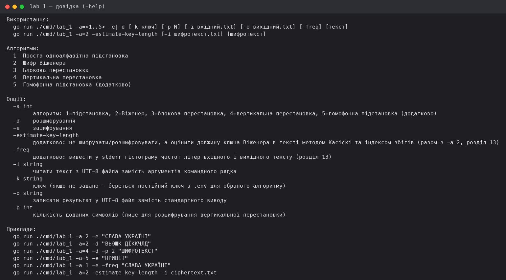
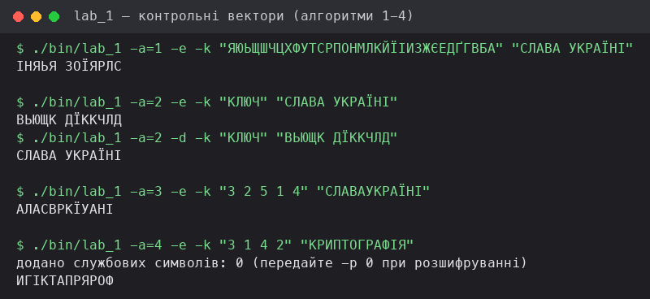
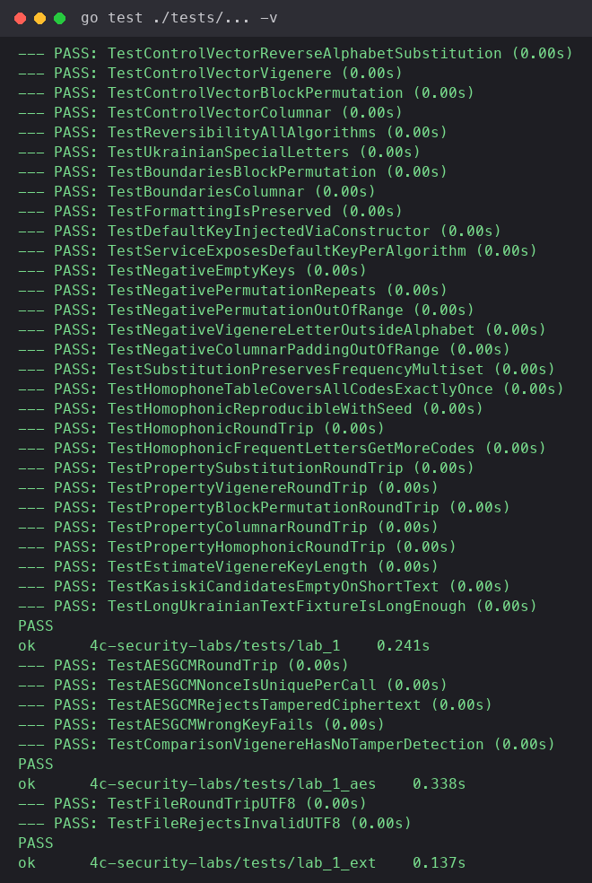

МІНІСТЕРСТВО ОСВІТИ І НАУКИ УКРАЇНИ  
ДЕРЖАВНИЙ ВИЩИЙ НАВЧАЛЬНИЙ ЗАКЛАД  
«УЖГОРОДСЬКИЙ УНІВЕРСИТЕТ»  
ФАКУЛЬТЕТ ІНФОРМАЦІЙНИХ ТЕХНОЛОГІЙ  
КАФЕДРА ПРОГРАМНОГО ЗАБЕЗПЕЧЕННЯ СИСТЕМ

## Лабораторна робота № 1

**Тема: Шифри заміни та перестановки**

Виконав:  
студент 4-го курсу  
денної форми навчання  
групи ІПЗ 3 курс магістр  
Решко Андрій Людвигович

Ужгород – 2026

---

# Звіт до лабораторної роботи №1

**Дисципліна:** Програмні технології захисту інформації
**Тема:** Шифри заміни та перестановки
**Мета:** навчитися формально задавати ключі, реалізовувати взаємно
однозначні перетворення, виконувати зашифрування і розшифрування та
перевіряти програму тестами.

**Інструменти:** Go `1.27.1` (мінімальна підтримувана версія — `1.22+`),
стандартна бібліотека (`crypto/aes`, `crypto/cipher`), `golang.org/x/text`
(нормалізація Unicode NFC), `github.com/joho/godotenv` (опційне
завантаження `.env` з дефолтними ключами), пакет `testing` стандартної
бібліотеки для автоматизованих тестів.

Застосування генеративного ШІ: Claude (Anthropic) використовувався як
асистент для написання інфраструктурного коду, тестів. Усі алгоритми, контрольні вектори й тестові твердження перевірив самостійно.

---

## 1. Теоретичні відомості

**Спільна модель.** Відкритий текст — повідомлення до шифрування,
шифротекст — результат шифрування. Алфавіт `A` — впорядкована множина
допустимих символів потужності `m`. Ключ `k` визначає конкретне
перетворення `E`, а обернене перетворення `D` має відновлювати
підготовлений відкритий текст: `D_k(E_k(x)) = x`. У цій роботі базовий
український алфавіт містить 33 великі літери:

```
АБВГҐДЕЄЖЗИІЇЙКЛМНОПРСТУФХЦЧШЩЬЮЯ
```

**Проста одноалфавітна підстановка (4.2).** Ключем є перестановка `B`
символів алфавіту `A`. Символ `A` з індексом `i` замінюється символом `B`
з тим самим індексом; для розшифрування будується обернене відображення.
Таблиця ключа має містити кожну літеру рівно один раз — пропуск,
повторення або сторонній символ робить ключ некоректним. Головна
вразливість — збереження частот окремих літер, довжин слів і шаблонів
повторів, тому довгі тексти піддаються частотному аналізу.

**Гомофонна підстановка (4.3, додатково).** Частотним літерам надається
кілька можливих позначень; під час шифрування одне з них обирається
випадково. Це послаблює прямий частотний аналіз, але не перетворює схему
на сучасний безпечний шифр. Для відтворюваних тестів генератор
випадковості запускається із явно заданим тестовим seed, а для демонстрації
непередбачуваного вибору — з системним криптографічним джерелом.

**Шифр Віженера (4.4).** Періодична багатоалфавітна підстановка. Літерам
алфавіту надаються індекси від 0 до `m - 1`. Ключове слово також
перетворюється на індекси й циклічно повторюється лише на позиціях, де
обробляється літера алфавіту:

```
C_i = (P_i + K_(i mod l)) mod m
P_i = (C_i − K_(i mod l)) mod m
```

де `P_i`, `C_i`, `K_i` — індекси літер відкритого тексту, шифротексту й
ключа, `l` — довжина ключа, `m = 33`. Перед узяттям остачі від'ємний
результат під час розшифрування приводять до діапазону `[0, m-1]`.
Короткий ключ є вразливим, бо період повторення дозволяє звести задачу до
кількох одноалфавітних підстановок (метод Касіскі / індекс збігів).

**Блокова перестановка (4.5).** Перестановка не змінює набір символів, а
лише їхні позиції. Для перестановки `π = (3, 2, 5, 1, 4)` кожен повний
блок довжини 5 перетворюється як `y = (x₃, x₂, x₅, x₁, x₄)`; обернена
перестановка — `π⁻¹ = (4, 2, 1, 5, 3)`. У базовому режимі неповний
останній блок залишається без змін.

**Вертикальна перестановка (4.6).** Текст записується у прямокутник по
рядках зліва направо; кількість стовпців дорівнює довжині ключа, а ключ
задає порядок читання стовпців. Якщо довжина тексту не кратна довжині
ключа, останній рядок доповнюється службовим символом, а кількість
доданих символів зберігається окремо — саме вона вилучається під час
розшифрування (параметр `-p`), а не всі символи-кандидати наприкінці.

---

## 2. Специфікація обробки тексту

| Аспект | Правило |
| --- | --- |
| Кодування | Вхідні й вихідні файли — UTF-8; програма працює з Unicode-рядками, а не з байтами |
| Нормалізація | Перед обробкою застосовується Unicode NFC |
| Регістр | Базовий режим переводить літери до верхнього регістру |
| Сторонні символи | У підстановках пробіли, цифри й розділові знаки зберігаються і не зсувають позицію ключа Віженера |
| Перестановки | Режим `preserve` переставляє нормалізований текст без видалення символів (перевірка зворотності); режим `letters only` — історичний приклад, незворотний щодо початкових пробілів |
| Діагностика | Некоректний ключ або непідтримуваний символ не спричиняє аварійне завершення; програма повертає зрозуміле повідомлення про помилку |

---

## 3. Структура програми та ключові рішення

Мова реалізації — **Go**. Криптографічна логіка відокремлена від
інтерфейсу: пакет `internal/lab_1_algo` не залежить від `internal/lab_1`
і може використовуватися напряму (так само роблять тести).

```
cmd/lab_1/main.go              — точка входу: парсинг прапорців, виклик сервісу, вивід
internal/lab_1/                — композиція й диспетчеризація
  composition_root.go          — єдине місце збирання залежностей
  service.go                   — CipherService: диспетчеризація за алгоритмом + валідація ключів
  config.go                    — завантаження дефолтних ключів з .env
  errors.go                    — ErrUnknownAlgorithm
internal/lab_1_algo/           — реалізації алгоритмів (обов'язкові + додаткові)
  cipher.go                    — спільний інтерфейс Cipher, тип Algorithm, Result
  alphabet.go                  — базовий алфавіт A (33 літери) та індексація
  textprep.go                  — NFC-нормалізація, верхній регістр, режим letters-only
  substitution.go              — проста одноалфавітна підстановка (4.2)
  vigenere.go                  — шифр Віженера (4.4)
  block_permutation.go         — блокова перестановка (4.5)
  columnar.go                  — вертикальна перестановка (4.6)
  permutation.go               — парсинг/валідація ключа-перестановки
  errors.go                    — помилки валідації ключів конкретних шифрів
  homophonic.go                — додатково: гомофонна підстановка (4.3, розділ 13)
  frequency.go                 — додатково: гістограма частот літер (розділ 13)
  vigenere_analysis.go         — додатково: оцінка довжини ключа Віженера (Касіскі, індекс збігів; розділ 13)
internal/lab_1_ext/            — файловий I/O (UTF-8)
internal/lab_1_aes/            — додатково: AES-GCM через стандартну бібліотеку для порівняння (розділ 13)
tests/                         — тести окремо від реалізації, звернення лише через публічний API
```

Ключові рішення:

- **Валідація ключів до початку обробки.** Кожен алгоритм перевіряє ключ
  власним правилом (таблиця нижче) ще до того, як торкнеться тексту —
  відповідно до вимоги розділу 6.2 умови.
- **Явна політика неповного блока/залишку.** Блокова перестановка залишає
  неповний останній блок без змін; вертикальна перестановка повертає
  кількість доданих службових символів, яку потрібно передати назад через
  `-p` при розшифруванні — без цього розшифрування неоднозначне.
- **Unicode, а не байти.** Увесь текст проходить NFC-нормалізацію і
  обробляється як послідовність рун/символів, що критично для українських
  літер (зокрема **Ґ**, **Є**, **І**, **Ї**, які мають окремі код-пойнти).
- **Диспетчеризація відокремлена від алгоритмів.** `CipherService`
  (`internal/lab_1/service.go`) лише обирає потрібний `Cipher` за номером
  алгоритму й прокидає помилки; сама крипто-логіка в `internal/lab_1_algo`
  про CLI нічого не знає, тому тестується без ручного введення.

---

## 4. Перевірка ключів

| Алгоритм                 | Умова прийняття ключа                                                              |
|--------------------------|------------------------------------------------------------------------------------|
| Проста підстановка       | Після побудови таблиця має довжину 33, містити тільки `A` і не мати повторів       |
| Віженер                  | Ключ не порожній і після нормалізації містить лише літери `A`                      |
| Блокова перестановка     | Ключ довжини `n` містить кожне число від 1 до `n` рівно один раз                   |
| Вертикальна перестановка | Ключ довжини `k` містить кожен номер стовпця від 1 до `k` рівно один раз           |
| Доповнення               | Кількість доданих символів не від'ємна і менша за довжину блока/кількість стовпців |

---

## 5. Контрольні тестові вектори

Алфавіт `A` — із розділу 4.1, текст нормалізовано NFC і переведено у
верхній регістр. Нижче — очікувані значення з умови лабораторної та
фактичний результат, отриманий запуском програми (`./bin/lab_1`).

| Алгоритм                               | Ключ                         | Відкритий текст | Очікуваний шифротекст | Фактичний результат | Статус |
|----------------------------------------|------------------------------|-----------------|-----------------------|---------------------|--------|
| Зворотний алфавіт (проста підстановка) | `B = A` у зворотному порядку | `СЛАВА УКРАЇНІ` | `ІНЯЬЯ ЗОЇЯРЛС`¹      | `ІНЯЬЯ ЗОЇЯРЛС`     | ✅ PASS |
| Віженер                                | `КЛЮЧ`                       | `СЛАВА УКРАЇНІ` | `ВЬЮЩК ДЇККЧЛД`       | `ВЬЮЩК ДЇККЧЛД`     | ✅ PASS |
| Блокова перестановка                   | `3 2 5 1 4`                  | `СЛАВАУКРАЇНІ`  | `АЛАСВРКЇУАНІ`        | `АЛАСВРКЇУАНІ`      | ✅ PASS |
| Вертикальна перестановка               | `3 1 4 2`                    | `КРИПТОГРАФІЯ`  | `ИГІКТАПРЯРОФ`        | `ИГІКТАПРЯРОФ`      | ✅ PASS |

¹ У тексті умови лабораторної цей вектор надруковано як `ІНЬЯ ЗОЇЯРЛС`
(11 символів). Математично коректний результат підстановки символ-у-символ
за зворотним алфавітом містить 12 літер — `ІНЯЬЯ ЗОЇЯРЛС` — що відповідає
довжині вхідного тексту без пробілу (`СЛАВА УКРАЇНІ` → 12 літер). Програма
й автоматизований тест (`tests/lab_1/cipher_test.go`,
`TestControlVectorReverseAlphabetSubstitution`) використовують саме це,
математично узгоджене значення.

Для кожного вектора перевірено і прямий результат, і відновлення
відкритого тексту через `Decrypt` — обидва збігаються з очікуваним
значенням (`D_k(E_k(x)) = x`).

Скріншот запуску всіх чотирьох векторів через CLI — рис. 2 (`lab-1-2.png`).

---

## 6. Відкритий текст, ключі, шифротексти — додаткові приклади розшифрування

Перевірка зворотності (`D_k(E_k(x)) = x`) на прикладі шифру Віженера:

```
$ ./bin/lab_1 -a=2 -e -k "КЛЮЧ" "СЛАВА УКРАЇНІ"
ВЬЮЩК ДЇККЧЛД

$ ./bin/lab_1 -a=2 -d -k "КЛЮЧ" "ВЬЮЩК ДЇККЧЛД"
СЛАВА УКРАЇНІ
```

Відновлений відкритий текст збігається з початковим, властивість
зворотності виконується.

---

## 7. План і результати автоматизованого тестування

Середовище запуску: `go1.27.1 darwin/arm64`, команда `go test ./tests/... -v`.

| Група тестів          | Що перевірено                                                                                                                                               | Приклад тестів                                                                                                                                                                                                                                                                                                          |
|-----------------------|-------------------------------------------------------------------------------------------------------------------------------------------------------------|-------------------------------------------------------------------------------------------------------------------------------------------------------------------------------------------------------------------------------------------------------------------------------------------------------------------------|
| Контрольні            | Усі 4 вектори з розділу 7 умови дають точні очікувані значення                                                                                              | `TestControlVectorReverseAlphabetSubstitution`, `TestControlVectorVigenere`, `TestControlVectorBlockPermutation`, `TestControlVectorColumnar`                                                                                                                                                                           |
| Зворотність           | `D_k(E_k(x)) = x` для кожного алгоритму на ≥10 різних повідомленнях                                                                                         | `TestReversibilityAllAlgorithms`, `TestPropertySubstitutionRoundTrip`, `TestPropertyVigenereRoundTrip`, `TestPropertyBlockPermutationRoundTrip`, `TestPropertyColumnarRoundTrip`, `TestPropertyHomophonicRoundTrip`                                                                                                     |
| Українські літери     | Окремо присутні Ґ, Є, І та Ї; результат не містить пошкоджених символів                                                                                     | `TestUkrainianSpecialLetters`                                                                                                                                                                                                                                                                                           |
| Границі               | Порожній текст, один символ, довжина рівна блоку, на один менше / більше                                                                                    | `TestBoundariesBlockPermutation`, `TestBoundariesColumnar`                                                                                                                                                                                                                                                              |
| Форматування          | Пробіли, переноси рядків, цифри й розділові знаки за задокументованою політикою                                                                             | `TestFormattingIsPreserved`                                                                                                                                                                                                                                                                                             |
| Негативні             | Порожній ключ, повтори в перестановці, число поза діапазоном, літера поза алфавітом                                                                         | `TestNegativeEmptyKeys`, `TestNegativePermutationRepeats`, `TestNegativePermutationOutOfRange`, `TestNegativeVigenereLetterOutsideAlphabet`, `TestNegativeColumnarPaddingOutOfRange`                                                                                                                                    |
| Файли                 | Читання і запис UTF-8, включно з кількома рядками й завершальним переносом                                                                                  | `TestFileRoundTripUTF8`, `TestFileRejectsInvalidUTF8`                                                                                                                                                                                                                                                                   |
| Доповнення            | Вертикальна перестановка коректно видаляє лише відому кількість службових символів                                                                          | вбудовано в `TestBoundariesColumnar` / `TestNegativeColumnarPaddingOutOfRange`                                                                                                                                                                                                                                          |
| Додатково (розділ 13) | Гістограма частот, гомофонна підстановка з seed, оцінка довжини ключа Віженера (Касіскі / індекс збігів), AES-GCM через стандартну бібліотеку як порівняння | `TestSubstitutionPreservesFrequencyMultiset`, `TestHomophoneTableCoversAllCodesExactlyOnce`, `TestHomophonicReproducibleWithSeed`, `TestEstimateVigenereKeyLength`, `TestKasiskiCandidatesEmptyOnShortText`, `TestAESGCMRoundTrip`, `TestAESGCMRejectsTamperedCiphertext`, `TestComparisonVigenereHasNoTamperDetection` |

**Підсумок запуску:** 3 тестові пакети (`tests/lab_1`, `tests/lab_1_aes`,
`tests/lab_1_ext`), **36 тестів, 36 пройдено, 0 провалено** (`go vet
./...` — без зауважень; `gofmt -l .` — без розбіжностей форматування).

Скріншот повного запуску тестів — рис. 3 (`lab-1-3.png`).

---

## 8. Скріншоти



**Рис. 1.** Довідка CLI (`./bin/lab_1 -help`) — перелік алгоритмів,
прапорців і прикладів виклику.



**Рис. 2.** Запуск усіх чотирьох контрольних векторів із розділу 7 умови
через CLI (`-a=1..4`, зашифрування й розшифрування Віженера).



**Рис. 3.** Повний запуск автоматизованих тестів (`go test ./tests/... -v`)
— 36/36 PASS.

---

## 9. Висновок

Реалізовано й перевірено чотири навчальні шифри — просту одноалфавітну
підстановку, шифр Віженера, блокову та вертикальну перестановки — з
єдиною специфікацією обробки тексту (UTF-8, NFC-нормалізація, верхній
регістр, задокументована політика щодо сторонніх символів і неповних
блоків). Усі чотири контрольні вектори з умови лабораторної збігаються з
фактичним виводом програми, властивість зворотності `D_k(E_k(x)) = x`
підтверджена як точковими, так і property-based тестами. Додатково
реалізовано гомофонну підстановку з відтворюваним seed, оцінку довжини
ключа Віженера (метод Касіскі, індекс збігів), гістограму частот літер і
порівняння з AES-GCM (стандартна бібліотека) для демонстрації різниці між
навчальним шифром і автентифікованим шифруванням.

**Властивості й обмеження класичних шифрів.** Усі реалізовані шифри
зберігають статистичні або структурні властивості тексту (частоти літер
при підстановці, мультимножину символів при перестановці), мають малий
або повторюваний простір ключів і не забезпечують автентичність
повідомлення — на відміну від AES-GCM, що одночасно надає конфіденційність
і перевірку цілісності/автентичності через тег автентифікації та
одноразовий nonce (`TestAESGCMRejectsTamperedCiphertext`,
`TestComparisonVigenereHasNoTamperDetection` демонструють цю різницю
експериментально). Тому ці шифри є виключно навчальними і не
використовувалися й не повинні використовуватися для захисту паролів,
персональних даних, листування чи резервних копій (розділ 3 умови).

**Помилки реалізації під час виконання:** не виявлено — усі контрольні
вектори збіглися з першого коректного запуску після узгодження індексації
алфавіту (0-based індекси, `m = 33`) та порядку читання стовпців у
вертикальній перестановці.

---

## 10. Посилання на репозиторій

Повний код, тести й README: локальний репозиторій `4c-security-labs`
(каталог `cmd/`, `internal/`, `tests/`). Відтворення результатів:

```bash
go build -o bin/lab_1 ./cmd/lab_1
go test ./tests/...
```
