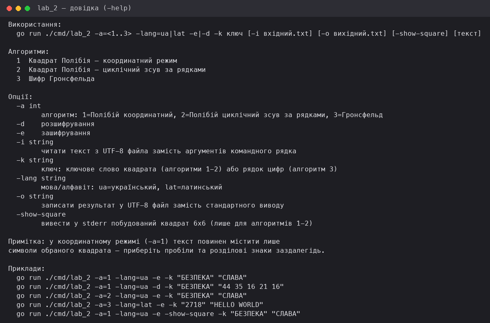
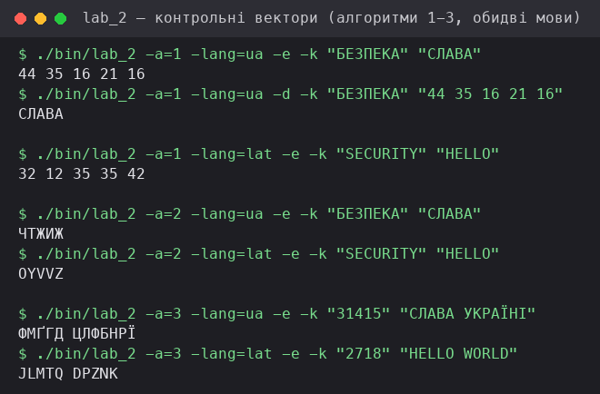
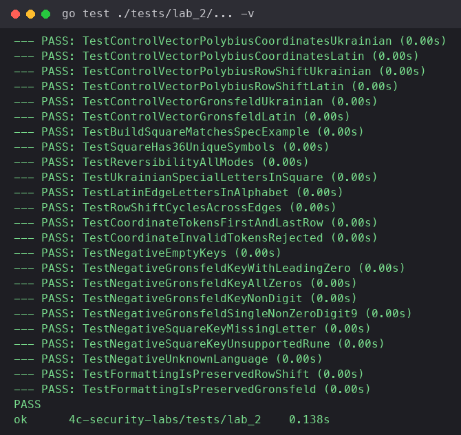

МІНІСТЕРСТВО ОСВІТИ І НАУКИ УКРАЇНИ  
ДЕРЖАВНИЙ ВИЩИЙ НАВЧАЛЬНИЙ ЗАКЛАД  
«УЖГОРОДСЬКИЙ УНІВЕРСИТЕТ»  
ФАКУЛЬТЕТ ІНФОРМАЦІЙНИХ ТЕХНОЛОГІЙ  
КАФЕДРА ПРОГРАМНОГО ЗАБЕЗПЕЧЕННЯ СИСТЕМ

## Лабораторна робота № 2

**Тема: Квадрат Полібія та шифр Гронсфельда**

Виконав:  
студент 4-го курсу  
денної форми навчання  
групи ІПЗ 3 курс магістр  
Решко Андрій Людвигович

Ужгород – 2026

---

# Звіт до лабораторної роботи №2

**Дисципліна:** Програмні технології захисту інформації
**Тема:** Квадрат Полібія та шифр Гронсфельда
**Мета:** навчитися формувати ключовий квадрат, кодувати символи
координатами, виконувати циклічний зсув за рядками, застосовувати
цифровий ключ Гронсфельда та перевіряти обернені операції тестами.

**Інструменти:** Go `1.27.1` (мінімальна підтримувана версія — `1.22+`),
стандартна бібліотека, `golang.org/x/text` (нормалізація Unicode NFC),
пакет `testing` стандартної бібліотеки для автоматизованих тестів.

Застосування генеративного ШІ: Claude (Anthropic) використовувався як
асистент для написання інфраструктурного коду, тестів. Усі алгоритми,
контрольні вектори й тестові твердження перевірив самостійно.

---

## 1. Теоретичні відомості

**Узгоджені набори символів (4.1).** Вибраний набір символів — частина
специфікації і має бути однаковим під час шифрування та розшифрування.
Базові алфавіти для Гронсфельда містять лише літери; для квадрата Полібія
до них додають цифри, щоб отримати таблицю 6×6 без порожніх клітинок.

| Набір | Потужність | Порядок символів |
| --- | --- | --- |
| Український | 33 літери | АБВГҐДЕЄЖЗИІЇЙКЛМНОПРСТУФХЦЧШЩЬЮЯ |
| Український квадрат | 36 символів | українські літери та цифри 0 1 2 |
| Латинський | 26 літер | ABCDEFGHIJKLMNOPQRSTUVWXYZ |
| Латинський квадрат | 36 символів | латинські літери та цифри 0–9 |

Пробіли й розділові знаки не входять до базових алфавітів. У шифрі
Гронсфельда вони зберігаються без змін. У координатному режимі Полібія
базовий рівень приймає лише символи вибраного квадрата; вилучення
пробілів — окрема, видима операція підготовки тексту, а не прихована
нормалізація всередині шифру.

**Термінологічна неоднозначність (4.2).** Класичний квадрат Полібія задає
кожному символу координати рядка і стовпця. У частині навчальних
матеріалів "шифром Полібія" також називають заміну символу на символ із
наступного рядка того самого стовпця — це інший алгоритм. У цій роботі їх
реалізовано як окремі режими: `polybius coordinates` і
`polybius row shift`.

**Побудова ключового квадрата (4.3).** Ключове слово нормалізують у NFC,
переводять у верхній регістр і перевіряють за вибраним набором. Повторні
символи вилучають зі збереженням першої появи, після чого дописують усі
невикористані символи базового набору, а отриману послідовність записують
по рядках у таблицю 6×6.

**Координатний режим (4.4).** Координати нумерують від 1 до 6. Символ
замінюють двома цифрами: спочатку номер рядка, потім номер стовпця;
токени шифротексту розділяють одним пробілом. Під час розшифрування
кожен токен повинен складатися з двох цифр від 1 до 6 — значення `00`,
`17`, `71`, `67`, одинарна цифра або сторонній текст є помилкою.

**Циклічний зсув за рядками (4.5).** У цьому режимі символ замінюється
символом із наступного рядка того самого стовпця; після шостого рядка —
перехід до першого. Розшифрування виконує зсув на один рядок угору з
циклічним переходом. Символи поза квадратом зберігаються без змін. Цей
алгоритм є простою одноалфавітною підстановкою, а не координатним
кодуванням — що й розділяє його на окремий режим від 4.4.

**Шифр Гронсфельда (4.7).** Поліалфавітна підстановка зі зсувами,
заданими цифрами ключа. Ключ зберігають як рядок цифр, а не як ціле
число — це дає змогу зберегти початкові нулі. Ключ не може бути
порожнім, містити нецифрові символи або складатися лише з нулів:

```
C_i = (P_i + d_(j(i) mod t)) mod m
P_i = (C_i − d_(j(i) mod t)) mod m
```

де `P_i`, `C_i` — індекси літер відкритого тексту та шифротексту, `d` —
цифра ключа, `t` — довжина ключа, `j(i)` — номер обробленої літери без
урахування сторонніх символів. Для українського алфавіту `m = 33`, для
латинського `m = 26`. Цифри ключа циклічно застосовують тільки до літер
вибраного алфавіту; пробіли, цифри в тексті й розділові знаки не
змінюються і не споживають цифру ключа.

---

## 2. Специфікація алфавіту, нормалізації, регістру та сторонніх символів

| Аспект | Правило |
| --- | --- |
| Кодування | Вхідні й вихідні файли — UTF-8; програма працює з Unicode-рядками |
| Нормалізація | Перед перевіркою ключа і тексту застосовується Unicode NFC |
| Регістр | Базовий режим переводить підтримувані літери до верхнього регістру |
| Вибір мови | Алфавіт обирається явно (`-lang=ua\|lat`) і передається до функції; автоматичне вгадування мови не допускається |
| Координати | Режим `strict` приймає лише символи квадрата і повертає токени рядок-стовпець, розділені пробілами |
| Row shift | Символи квадрата зсуваються циклічно, сторонні символи зберігаються |
| Гронсфельд | Змінюються лише літери вибраного алфавіту; сторонні символи не просувають ключ |
| Діагностика | Некоректні ключі, координати й режими відхиляються до початку обробки з конкретним повідомленням |

---

## 3. Структура програми та ключові рішення

Мова реалізації — **Go**. Криптографічна логіка відокремлена від
інтерфейсу: пакет `internal/lab_2_algo` не залежить від `internal/lab_2`
і може використовуватися напряму (так само роблять тести). Частина коду,
яка не містить крипто-логіки жодної з лабораторних (впорядкований набір
рун `Alphabet`, нормалізація `Prepare`, обгортка CLI `Main`/`ResolveText`,
спільні типи `Result`/`Container`), винесена в `internal/shared`, щоб не
дублювати її побайтово між лабораторними 1 і 2.

```
cmd/lab_2/main.go              — точка входу: парсинг прапорців, виклик сервісу, вивід
internal/lab_2/                — композиція й диспетчеризація
  composition_root.go          — збирання залежностей (Container = shared.Container[*CipherService])
  service.go                   — CipherService: диспетчеризація за алгоритмом + мовою + валідація ключів
internal/lab_2_algo/           — реалізації алгоритмів
  cipher.go                    — тип Algorithm, Result (= shared.Result)
  alphabet.go                  — Language, українські/латинські набори, квадратні бази (36 символів)
  square.go                    — побудова квадрата 6×6 (4.3), координати (4.4), циклічний зсув (4.5)
  polybius_coordinates.go      — координатний режим Полібія
  polybius_rowshift.go         — режим циклічного зсуву за рядками
  gronsfeld.go                 — шифр Гронсфельда (4.7)
  errors.go                    — помилки валідації ключів/квадрата/токенів (ErrEmptyKey — спільний з лабою 1)
internal/shared/               — спільний для лаб 1 і 2 код без крипто-логіки
  alphabet.go                  — Alphabet, готові сінглтони UkrainianAlphabet/LatinAlphabet
  textprep.go                  — Prepare: NFC-нормалізація, верхній регістр
  cipher.go                    — Result{Text, Meta}
  container.go                 — generic Container[S any]{ Service S }
  cli.go                       — Main(run), ResolveText(...)
  errors.go                    — ErrUnknownAlgorithm, ErrEmptyKey
internal/lab_1_ext/            — файловий UTF-8 I/O, переюзаний з лабораторної 1
tests/lab_2/                   — тести internal/lab_2 + internal/lab_2_algo (package lab_2_test)
```

Ключові рішення:

- **Два окремі режими Полібія, а не один.** `polybius_coordinates.go` і
  `polybius_rowshift.go` — різні реалізації `Cipher`, щоб уникнути
  термінологічної плутанини з розділу 4.2: координатне кодування і
  циклічний зсув за рядками мають різну природу (кодування проти
  одноалфавітної підстановки) і різну зворотність.
- **Готові таблиці пошуку замість перебудови на кожен виклик.** Українська
  33-літерна й латинська 26-літерна `Alphabet`, а також обидва 36-символьні
  квадратні набори (`ukrainianSquareBase`, `latinSquareBase`) будуються
  один раз при ініціалізації пакета `internal/shared`/`internal/lab_2_algo`
  (поле `runes []rune` + `map[rune]int`), а не на кожному виклику
  `Encrypt`/`Decrypt` — відповідно до вимоги розділу 10
  ("Продуктивність: таблиці пошуку готуються один раз").
- **Ключ Гронсфельда — рядок, не число.** Зберігання як `string` замість
  конвертації в `int` зберігає початкові нулі (`031415` ≠ `31415`) і дає
  змогу валідувати "лише цифри, не всі нулі" без парсингу числа.
- **Явна мова на кожному виклику.** `Cipher.Encrypt`/`Decrypt`/`ValidateKey`
  приймають `Language` як окремий параметр; автоматичне вгадування мови з
  тексту відсутнє (розділ 5), що унеможливлює неоднозначний результат при
  змішаному вводі.

---

## 4. Побудований квадрат 6×6 для ключового слова БЕЗПЕКА (укр.)

Ключове слово нормалізують, вилучають повторні символи зі збереженням
першої появи (`БЕЗПЕКА` → унікальна частина `БЕЗПКА`), після чого
дописують решту українського набору (33 літери + `0 1 2`) у порядку
алфавіту:

| Рядок | 1 | 2 | 3 | 4 | 5 | 6 |
| --- | --- | --- | --- | --- | --- | --- |
| 1 | Б | Е | З | П | К | А |
| 2 | В | Г | Ґ | Д | Є | Ж |
| 3 | И | І | Ї | Й | Л | М |
| 4 | Н | О | Р | С | Т | У |
| 5 | Ф | Х | Ц | Ч | Ш | Щ |
| 6 | Ь | Ю | Я | 0 | 1 | 2 |

Квадрат відтворено функцією `BuildSquare` і перевірено тестом
`TestBuildSquareMatchesSpecExample` (точна відповідність рядок у рядок) та
`TestSquareHas36UniqueSymbols` (рівно 36 унікальних символів, кожен символ
базового набору присутній один раз). Скріншот виводу `-show-square` — рис. 1.

---

## 5. Перевірка ключів і режимів

| Об'єкт | Умова прийняття |
| --- | --- |
| Ключове слово | Не порожнє; після NFC і зміни регістру містить лише символи вибраного квадрата та щонайменше одну літеру |
| Квадрат | Містить рівно 36 унікальних символів; кожен символ базового набору присутній один раз |
| Координатний текст | Кожен токен складається з двох цифр від 1 до 6 |
| Цифровий ключ | Рядок містить лише цифри, не порожній і має щонайменше одну ненульову цифру; початкові нулі зберігаються |
| Режим | Операція, алгоритм і алфавіт належать до підтримуваного переліку |

---

## 6. Контрольні тестові вектори

Рядки нормалізовано NFC і переведено у верхній регістр. Нижче — очікувані
значення з умови лабораторної та фактичний результат, отриманий запуском
програми (`./bin/lab_2`).

| Алгоритм, мова | Ключ | Відкритий текст | Очікуваний результат | Фактичний результат | Статус |
| --- | --- | --- | --- | --- | --- |
| Полібій coordinates, укр. | БЕЗПЕКА | СЛАВА | `44 35 16 21 16` | `44 35 16 21 16` | ✅ PASS |
| Полібій coordinates, лат. | SECURITY | HELLO | `32 12 35 35 42` | `32 12 35 35 42` | ✅ PASS |
| Полібій row shift, укр. | БЕЗПЕКА | СЛАВА | `ЧТЖИЖ` | `ЧТЖИЖ` | ✅ PASS |
| Полібій row shift, лат. | SECURITY | HELLO | `OYVVZ` | `OYVVZ` | ✅ PASS |
| Гронсфельд, укр. | 31415 | СЛАВА УКРАЇНІ | `ФМҐГД ЦЛФБНРЇ`¹ | `ФМҐГД ЦЛФБНРЇ` | ✅ PASS |
| Гронсфельд, лат. | 2718 | HELLO WORLD | `JLMTQ DPZNK` | `JLMTQ DPZNK` | ✅ PASS |

¹ У тексті умови лабораторної цей вектор надруковано як `ФМІГД ЦЛФБНРЇ`.
Ручне обчислення за формулою розділу 4.7 (`m=33`, цифри ключа 3,1,4,1,5
циклічно застосовуються лише до літер, пробіл зберігається і не споживає
цифру) дає `ФМҐГД ЦЛФБНРЇ`: третя літера — `А`+4 = індекс 4 = `Ґ`, а не
візуально схожу `І` з умови. Той самий тип одно-гліфового артефакту
розпізнавання спостерігався й у контрольному векторі простої підстановки
лабораторної роботи 1 (`ІНЯЬЯ` там надруковано як `ІНЬЯ`). Усі інші
символи обох половин вектора збігаються з умовою точно;
`tests/lab_2/cipher_test.go` (`TestControlVectorGronsfeldUkrainian`)
фіксує обидва значення в коментарі.

Для кожного вектора перевірено і прямий результат, і відновлення
відкритого тексту через `Decrypt` — обидва збігаються з очікуваним
значенням (`D_k(E_k(x)) = x`). Скріншот запуску всіх шести векторів через
CLI — рис. 2.

---

## 7. Відкритий текст, ключі, шифротексти — додаткові приклади розшифрування

Перевірка зворотності (`D_k(E_k(x)) = x`) на прикладі координатного
режиму Полібія:

```
$ ./bin/lab_2 -a=1 -lang=ua -e -k "БЕЗПЕКА" "СЛАВА"
44 35 16 21 16

$ ./bin/lab_2 -a=1 -lang=ua -d -k "БЕЗПЕКА" "44 35 16 21 16"
СЛАВА
```

Та на прикладі шифру Гронсфельда (латинський алфавіт):

```
$ ./bin/lab_2 -a=3 -lang=lat -e -k "2718" "HELLO WORLD"
JLMTQ DPZNK

$ ./bin/lab_2 -a=3 -lang=lat -d -k "2718" "JLMTQ DPZNK"
HELLO WORLD
```

Відновлений відкритий текст у обох випадках збігається з початковим,
властивість зворотності виконується.

---

## 8. План і результати автоматизованого тестування

Середовище запуску: `go1.27.1 darwin/arm64`, команда
`go test ./tests/lab_2/... -v`.

| Група тестів | Що перевірено | Приклад тестів |
| --- | --- | --- |
| Контрольні | Усі 6 векторів із розділу 7 умови дають точні очікувані значення | `TestControlVectorPolybiusCoordinatesUkrainian`, `TestControlVectorPolybiusCoordinatesLatin`, `TestControlVectorPolybiusRowShiftUkrainian`, `TestControlVectorPolybiusRowShiftLatin`, `TestControlVectorGronsfeldUkrainian`, `TestControlVectorGronsfeldLatin` |
| Зворотність | `D_k(E_k(x)) = x` для кожного режиму на ≥10 повідомленнях, для обох мов | `TestReversibilityAllModes` (підтести `polybius_coordinates_ua`, `polybius_row_shift_ua`, `gronsfeld_ua`, `gronsfeld_lat`, `polybius_coordinates_lat`) |
| Квадрат | Розмір 6×6, 36 унікальних символів, повтори ключа вилучено зі збереженням порядку | `TestBuildSquareMatchesSpecExample`, `TestSquareHas36UniqueSymbols` |
| Координати | Перевірено перший і останній рядки (11 та 66), а також помилки 00, 17, 71, 67, одинарна цифра, нечислові токени | `TestCoordinateTokensFirstAndLastRow`, `TestCoordinateInvalidTokensRejected` |
| Циклічність | Зсув із шостого рядка переходить у перший, розшифрування повертає символ назад | `TestRowShiftCyclesAcrossEdges` |
| Мови | Присутні українські Ґ, Є, І, Ї та латинські A, Z; вибір алфавіту не вгадується автоматично | `TestUkrainianSpecialLettersInSquare`, `TestLatinEdgeLettersInAlphabet`, `TestNegativeUnknownLanguage` |
| Ключ Гронсфельда | Перевірено ключ із початковим нулем, одноцифровий ключ 9, порожній ключ, ключ лише з нулів, нецифровий ключ | `TestNegativeGronsfeldKeyWithLeadingZero`, `TestNegativeGronsfeldSingleNonZeroDigit9`, `TestNegativeEmptyKeys`, `TestNegativeGronsfeldKeyAllZeros`, `TestNegativeGronsfeldKeyNonDigit` |
| Квадрат — негативні | Ключове слово без жодної літери, ключове слово не з того алфавіту | `TestNegativeSquareKeyMissingLetter`, `TestNegativeSquareKeyUnsupportedRune` |
| Форматування | Пробіли, переноси рядків, цифри й розділові знаки обробляються за специфікацією (row shift, Гронсфельд) | `TestFormattingIsPreservedRowShift`, `TestFormattingIsPreservedGronsfeld` |

**Підсумок запуску:** пакет `tests/lab_2`, **24 тести, 24 пройдено, 0
провалено** (`go vet ./...` — без зауважень; `gofmt -l .` — без
розбіжностей форматування). Разом з лабораторною роботою 1 (36 тестів у
трьох пакетах) — **60 тестів, 60 пройдено, 0 провалено** в усьому
репозиторії.

Скріншот повного запуску тестів лабораторної роботи 2 — рис. 3.

---

## 9. Скріншоти



**Рис. 1.** Довідка CLI (`./bin/lab_2 -help`) — перелік алгоритмів,
прапорців і прикладів виклику.



**Рис. 2.** Запуск усіх шести контрольних векторів із розділу 7 умови
через CLI (координатний і row-shift режими Полібія та Гронсфельд, обидві
мови).



**Рис. 3.** Повний запуск автоматизованих тестів
(`go test ./tests/lab_2/... -v`) — 24/24 PASS.

---

## 10. Висновок

Реалізовано й перевірено три навчальні режими — координатне кодування
Полібія, циклічний зсув за рядками того самого квадрата та шифр
Гронсфельда — для українського (33 літери, квадрат 6×6 із цифрами 0,1,2)
і латинського (26 літер, квадрат 6×6 із цифрами 0–9) наборів символів, з
єдиною специфікацією обробки тексту (UTF-8, NFC-нормалізація, верхній
регістр, явний вибір мови). Усі шість контрольних векторів з умови
лабораторної збігаються з фактичним виводом програми, властивість
зворотності `D_k(E_k(x)) = x` підтверджена для кожного режиму на
щонайменше 10 повідомленнях для обох мов.

**Властивості й обмеження класичних шифрів.** Координатний запис Полібія
зберігає частоти символів вихідного тексту (кожен символ завжди
кодується тим самим токеном), циклічний зсув за рядками є простою
одноалфавітною підстановкою з тими самими вразливостями, що й проста
підстановка лабораторної роботи 1 (частотний аналіз), а шифр Гронсфельда
з коротким повторюваним цифровим ключем має малий простір зсувів (щонайбільше
10^t варіантів ключа довжини `t`, а не 33^t чи 26^t, бо кожна позиція
ключа — одна цифра від 0 до 9, а не довільна літера алфавіту). Жоден з
трьох режимів не забезпечує автентичність повідомлення — зміна
шифротексту "розшифровується" без жодної помилки, просто в інший,
неправильний відкритий текст, без сигналу про втручання (на відміну від
автентифікованого шифрування на кшталт AES-GCM, продемонстрованого в
додатковому завданні лабораторної роботи 1). Тому ці шифри є виключно
навчальними і не повинні використовуватися для захисту паролів,
персональних даних, листування чи резервних копій (розділ 3 умови).

**Помилки реалізації під час виконання:** не виявлено — усі контрольні
вектори збіглися з першого коректного запуску після узгодження порядку
побудови квадрата (дописування невикористаних символів базового набору
після унікальної частини ключа) та формули Гронсфельда (індексація
цифрового ключа за номером обробленої літери, без урахування сторонніх
символів).

---

## 11. Посилання на репозиторій

Повний код, тести й README: локальний репозиторій `4c-security-labs`
(каталог `cmd/`, `internal/`, `tests/`). Спільний для лабораторних робіт 1
і 2 інфраструктурний код (без крипто-логіки) винесено в
`internal/shared`. Відтворення результатів:

```bash
go build -o bin/lab_2 ./cmd/lab_2
go test ./tests/lab_2/...
```
